<!--
Medium draft — paste into Medium and upload the images from docs/blog/images/
at each figure marker. Tables: Medium has no native tables; recreate the
overview table as an image or keep it as a code block / bulleted list on import.
-->

# Nine Multi-Agent Architectures, One Playground

*What I learned building every major multi-agent coordination pattern on the same stack — and a proposed way to group them.*

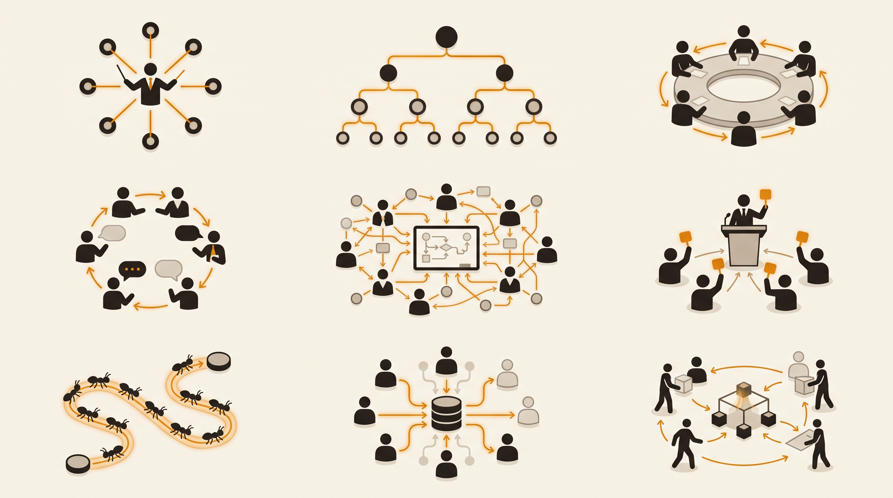

## Why I wrote this

Over the last couple of years, "multi-agent" went from a research curiosity to the default answer in every AI architecture discussion. Anthropic published how their multi-agent research system works. OpenAI shipped Swarm and a practical guide to building agents. LangGraph, AutoGen, and CrewAI each grew their own vocabulary for roughly the same ideas. And inside companies, teams are quietly running orchestrators, debate loops, and bidding systems in production — without calling them that, and without much of it ever being written down.

That was the itch. I'm a big fan of design patterns and system design, and I build AI products for a living. When I sat down to get up to speed on the move from single agents — or agentic workflows — to multi-agent systems, I found plenty of papers and plenty of frameworks, but **nothing like a shared catalogue**.

To be fair, pieces of one exist. Anthropic's "Building effective agents" names a handful of patterns. Azure's Architecture Center documents five orchestration patterns; Google's ADK guide ships eight with code. Academic surveys propose coordination taxonomies, and there's even a peer-reviewed, Gang-of-Four-style pattern catalogue for foundation-model agents. Antonio Gulli's 424-page *Agentic Design Patterns* — the closest thing to a shared pattern book today — gives multi-agent coordination one chapter out of twenty-one. But each of these covers a different slice, under different names, with no way to run the patterns against each other. There's still no equivalent of the Gang of Four for agent *coordination* specifically: no catalogue that says here are the patterns, here's what each one is called, here's when you reach for which — and here's what happens when you actually run them. The patterns exist, but they're fragmented — embedded in one company's engineering blog, one framework's abstractions, one paper's experimental setup. Every team seems to rediscover them independently and name them differently.

The best way I know to actually learn something is to build it. So I built all of them — nine coordination patterns, implemented on the same stack (Next.js + the Vercel AI SDK), streaming live, with per-step cost estimates, so they can be compared on equal footing. The result is [MAT — Multi-Agent Team](https://mat.umai-tech.com), an open-source playground where you can run the same request through any of the nine architectures and watch how differently they behave.

This post is the writeup: all nine patterns, what each one is, how it works, when to use it, and what it costs you. And since no one had stitched the fragments into a coordination-specific taxonomy, I'm proposing one — three clusters of three, grouped by *coordination style*. Treat the clustering as my take, not an industry standard — writing it down in the open is the whole point.

## The nine architectures at a glance

Here is the full lineup. Each pattern is implemented as its own runner and API route in the [MAT repo](https://github.com/MarcusElwin/multi-agents-team), so the descriptions below are grounded in working code, not just diagrams.

| # | Pattern | In one line | Best when | Main trade-off |
| --- | --- | --- | --- | --- |
| v1 | **Orchestrated** | A coordinator plans and delegates to specialists, then synthesizes. | Linear pipelines with clear steps. | Coordinator is a bottleneck; no parallelism. |
| v2 | **Choreographed** | Peers message each other over a bus until all are done. | Cross-functional negotiation on a shared artifact. | Convergence isn't guaranteed. |
| v3 | **Hierarchical** | A lead spawns sub-agents at runtime; results roll up a tree. | Open-ended tasks with nested subtasks. | Emergent tree shape; more tokens. |
| v4 | **Evaluator–Optimizer** | Generate → critique → revise until a bar is met. | Iteratively improving one artifact. | Cost grows per round. |
| v5 | **Debate** | Opposing sides argue; a judge decides. | Decisions where both cases should be heard. | Verdict quality depends on the judge. |
| v6 | **Blackboard** | Agents share one workspace; a controller picks who acts next. | Answers assembled from partial contributions. | Controller can loop; slower. |
| v7 | **Market** | Agents bid on posted tasks; best bid wins. | Heterogeneous work, unclear assignment. | The bid round is extra LLM calls. |
| v8 | **Self-Consistency** | Sample N attempts in parallel; a judge picks or merges. | Agreement across attempts signals quality. | N× tokens for sampling. |
| v9 | **Swarm** | Identical agents build on a shared scratchpad. | Open-ended ideation via many cheap passes. | Redundancy and drift. |

Nine patterns is a lot to hold in your head as a flat list. Once I had built them all, though, a structure emerged. Every pattern answers one question differently: **who decides what happens next?** Group by that answer and you get three clusters of three:

1. **Centralized — someone is in charge.** A coordinator, a lead, or a controller decides who acts (v1 Orchestrated, v3 Hierarchical, v6 Blackboard).
2. **Iterative — a loop pushes toward quality.** Nobody is "in charge"; a structured loop of generation and judgment drives the run (v4 Evaluator–Optimizer, v5 Debate, v8 Self-Consistency).
3. **Decentralized — nobody is in charge.** Coordination emerges from peers messaging, bidding, or leaving traces (v2 Choreographed, v7 Market, v9 Swarm).

The clusters also form an arc from most control to least: as you move from cluster 1 to cluster 3 you trade predictability for emergence. That trade is the recurring theme of this post.

## Cluster 1 — Centralized: someone is in charge

These are the patterns where a distinguished component — a coordinator, a lead agent, a controller — decides who does what. They are the most predictable and the easiest to debug, which is why most production multi-agent systems start here.

Why these three belong together: in each one, a single component holds the routing decision — no worker acts unless the center says so. What separates them is *what the center consults to decide*. In v1 it follows a plan it made up front; in v3 it invents the org chart itself at runtime, so the decision includes *who exists*; in v6 it reads the current state of the work and picks whoever the board says is needed next. Same authority, increasingly dynamic inputs — a plan, a tree, a workspace.

### v1 · Orchestrated

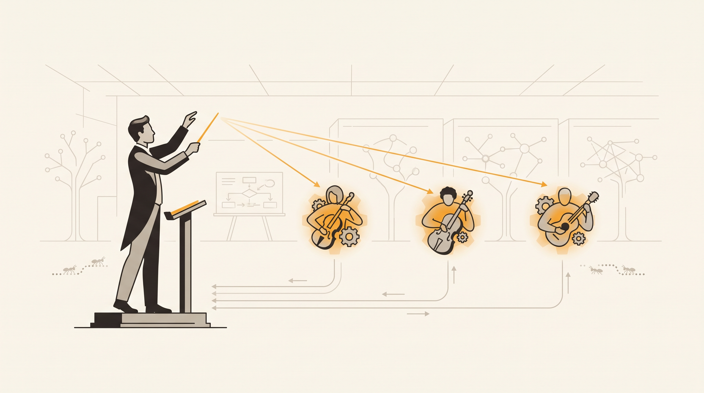

The workhorse. A central coordinator analyzes your request, plans a workflow, and delegates to specialists one at a time — in MAT's implementation, a researcher, a writer, and an editor — then synthesizes their results into a final answer.

How it works:

1. The coordinator analyzes the request and plans an ordered workflow.
2. It delegates to one specialist at a time (researcher → writer → editor), passing context forward.
3. Each specialist does its work and returns to the coordinator.
4. The coordinator synthesizes the results into a final answer.

This is Anthropic's *orchestrator-workers* pattern from "Building effective agents," and it's the one you've most likely already built, perhaps without naming it. It's canon everywhere: Gulli's pattern book illustrates its "Expert Teams" collaboration form with, literally, "a researcher, a writer, an editor." In MAT the coordinator loop is capped at **15 iterations**.

**Use it when** the task is a linear pipeline whose steps and order are clear up front — content production is the canonical case.

**The trade-off:** a single coordinator is both a bottleneck and a single point of failure, and nothing runs in parallel. Every hop back through the coordinator costs a full LLM turn.

Field note from building it: a strong coordinator plus cheap specialists is reliable and easy to debug — but keep the coordinator's turns short and its delegation explicit, or it eats your budget doing management overhead.

*Deep dive & live demo: [mat.umai-tech.com/architectures/v1](https://mat.umai-tech.com/architectures/v1)*

### v3 · Hierarchical

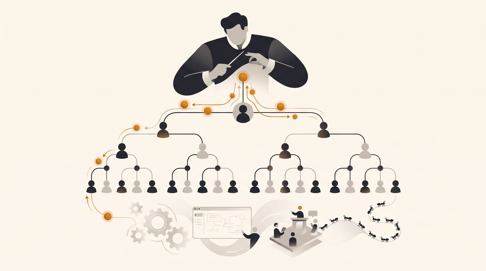

Orchestration, recursively. A lead agent decomposes the task *at runtime*, spawning a sub-agent for each part — and those sub-agents can spawn their own children, forming a tree. Sibling children run in parallel, and each parent synthesizes its children's results on the way back up.

How it works:

1. A lead agent decomposes the task into sub-tasks at runtime.
2. It spawns a sub-agent per part; sub-agents can spawn their own children (depth-capped).
3. Sibling children run in parallel; research-oriented leaves get a real web-search tool.
4. Each parent synthesizes its children's deliverables up to a final answer.

The key difference from v1: the org chart isn't fixed. The structure of the team is itself an output of the LLM's planning. This is essentially the shape of Anthropic's production multi-agent research system — a lead agent with dynamically spawned subagents. MAT caps the tree at **depth 2, width 4, and 15 nodes** total, because without caps the tree is unbounded by construction.

**Use it when** the task is open-ended and naturally breaks into nested, independent subtasks — research reports, "plan and build" requests, anything where you can't enumerate the steps up front.

**The trade-off:** the emergent tree shape is less predictable than a fixed pipeline, and recursion is expensive — every parent adds a synthesis pass, so token cost grows with the tree.

Field note: recursive decomposition shines on open-ended work, but cap depth and width from day one and watch cost. The tree *will* surprise you.

*Deep dive & live demo: [mat.umai-tech.com/architectures/v3](https://mat.umai-tech.com/architectures/v3)*

### v6 · Blackboard

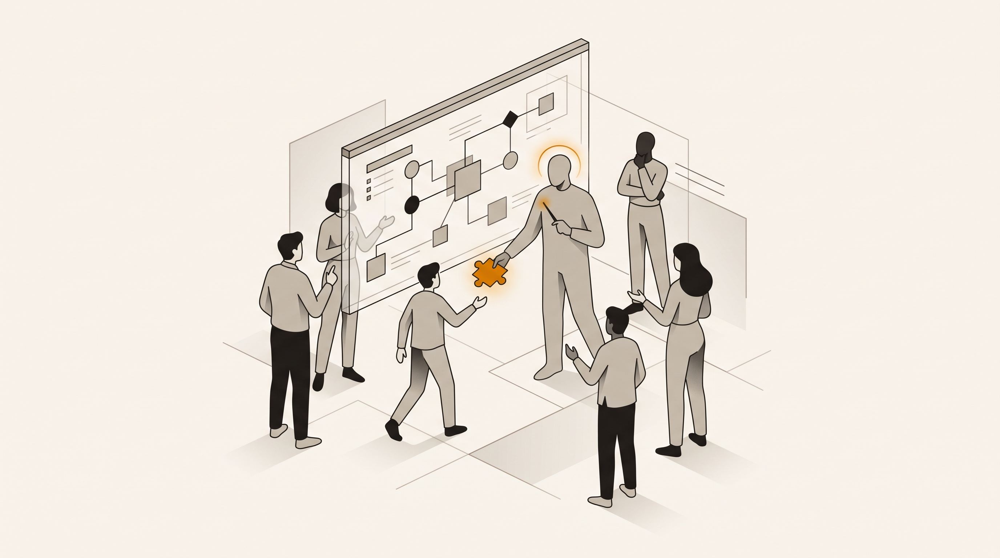

The oldest idea in the cluster — the blackboard architecture dates back to 1970s AI systems like Hearsay-II, and it's recently been revived for LLM agents. Agents share a structured workspace (the blackboard) divided into named sections. A controller inspects the board each round and selects who should act next *based on what's on the board* — not a fixed schedule. The chosen agent reads the whole board, contributes to a section, and writes back.

How it works:

1. Agents (in MAT: an analyst, a planner, and a critic) share a structured blackboard of named sections.
2. Each round, a controller inspects the board and picks who acts next based on its content.
3. The chosen agent reads the whole board, contributes a section, and writes back.
4. The loop continues until a solution emerges or the board stops changing (capped at 8 rounds).

Content-driven control is what earns blackboard its own slot: in v1 the plan decides the sequence, here the *state of the work* decides it. That makes it a hinge point between this cluster and the decentralized one — there's still a controller, but it follows the board rather than a plan.

**Use it when** the answer assembles from many partial contributions converging on a shared artifact — diagnosis, planning, anything where facts, proposals, and critiques accumulate.

**The trade-off:** controller selection can loop, and with no direct peer messaging, coordination is slower than a bus.

Field note: content-driven control is powerful for shared-intelligence problems, but it's noticeably slower than direct messaging. Budget rounds accordingly.

*Deep dive & live demo: [mat.umai-tech.com/architectures/v6](https://mat.umai-tech.com/architectures/v6)*

## Cluster 2 — Iterative: a loop pushes toward quality

The second cluster gives up on managing *who* works and instead structures *how quality happens*. Each of these patterns wraps generation in a loop or a contest, with some form of judge deciding when the output is good enough. They're the patterns to reach for when your problem isn't decomposition but reliability.

Why these three belong together: none of them has a boss — the *protocol* is in charge. Generation happens, judgment happens, and code decides whether to go another round. The intricacy is in where the pressure comes from: v4 applies it *sequentially* (the same artifact revised against explicit critique), v5 applies it *adversarially* (two positions attack each other before judgment), and v8 applies it *statistically* (independent attempts that never see each other, reconciled at the end). Refine, contest, sample — three ways to buy reliability with extra tokens.

### v4 · Evaluator–Optimizer

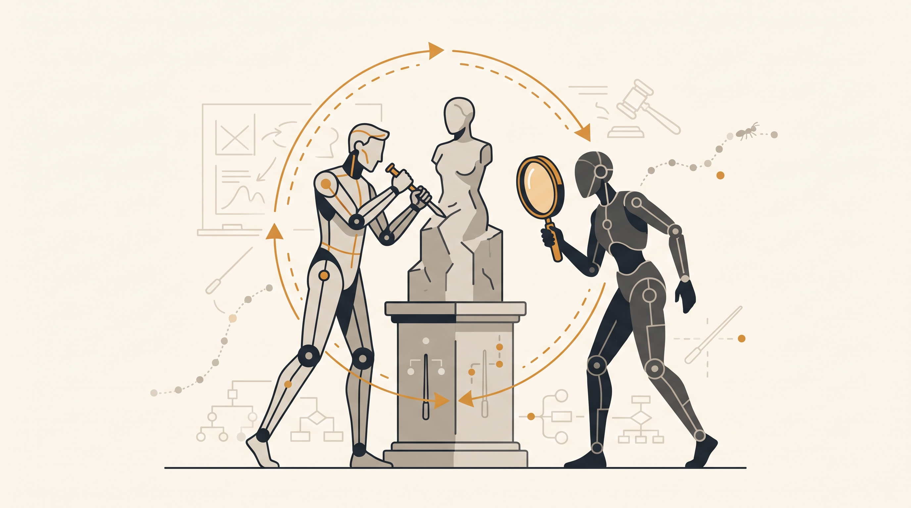

The tightest loop in the set. A generator produces a draft; a critic scores it against a rubric and lists concrete issues; the generator revises. Repeat until the critic passes it or the round budget runs out.

How it works:

1. A generator produces a first draft of the deliverable.
2. A critic scores it 0–10 against a rubric and lists concrete issues.
3. The generator revises, addressing each issue.
4. The loop repeats until the critic passes (**score ≥ 8** in MAT) or a max of **4 rounds**.

This is Anthropic's *evaluator-optimizer* pattern, and its intellectual ancestor is the Reflexion paper — agents improving through verbal self-critique rather than fine-tuning.

**Use it when** you have a single artifact you want iteratively pushed to a quality bar — a draft, a spec, a function, an executive summary.

**The trade-off:** cost grows linearly with rounds, and a never-satisfied critic will happily burn the entire budget without converging.

Field note: a demanding critic plus a *concrete* rubric is the whole game. Vague rubrics give vague gains; specific, actionable issues drive real improvement round over round. If I could only keep two patterns from the nine, this would be one of them.

*Deep dive & live demo: [mat.umai-tech.com/architectures/v4](https://mat.umai-tech.com/architectures/v4)*

### v5 · Debate

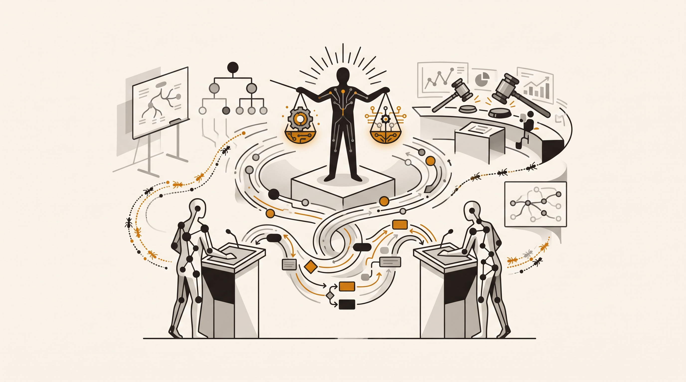

Adversarial quality control. Two debaters are assigned opposing positions on your question and argue across several rounds, each directly rebutting the other's last point. A judge then reads the full transcript and either picks the stronger side or synthesizes a consensus, with reasoning.

How it works:

1. Two debaters are assigned opposing positions on the question.
2. They argue across three rounds, each rebutting the other's last point.
3. A judge reads the full transcript.
4. The judge picks the stronger side or synthesizes a consensus, with reasoning.

The lineage here is unusually direct: OpenAI's 2018 "AI Safety via Debate" proposed adversarial argument as an alignment mechanism, and the 2023 multiagent-debate paper showed it improves factuality and reasoning in practice. The idea keeps compounding — Microsoft has since formalized Chain of Debates (CoD), where diverse models argue like an AI council, and Graph of Debates (GoD), where arguments become a dynamic network of nodes connected by "supports" and "refutes" edges.

**Use it when** you face a genuine decision or trade-off — SQL vs. NoSQL, monolith vs. microservices, build vs. buy — and you want the strongest case for each side *before* a verdict, instead of a single model's first instinct.

**The trade-off:** you pay for rounds of argument before getting any answer, and the verdict is only as good as the judge.

Field note: the judge matters as much as the debaters. A weak judge just averages the two positions; a good one actually weighs them.

*Deep dive & live demo: [mat.umai-tech.com/architectures/v5](https://mat.umai-tech.com/architectures/v5)*

### v8 · Self-Consistency

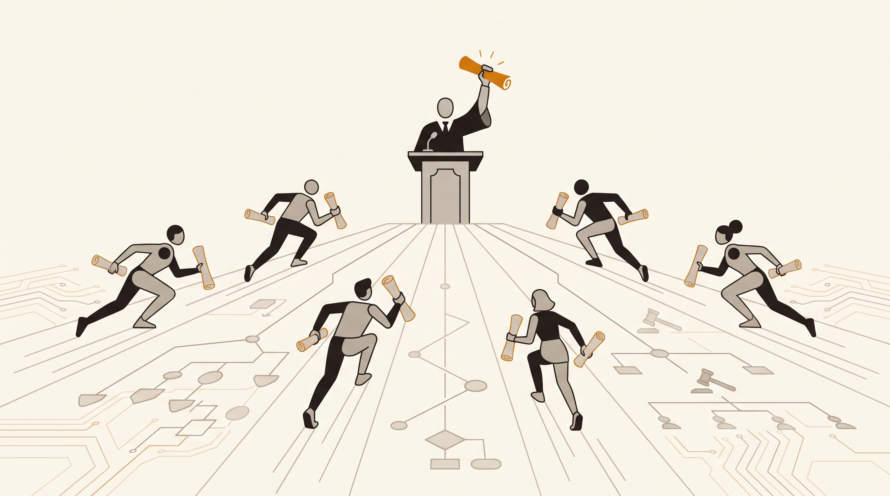

The simplest pattern in the entire post, and one of the most cost-effective. The same task is sent to N samplers that run independently and in parallel, each unaware of the others. A judge reads all the candidates and either selects the strongest or merges complementary answers into one.

How it works:

1. The task is sent to N sampler agents (4 in MAT) that run independently and in parallel.
2. Each produces its own complete answer, unaware of the others.
3. A judge reads all N candidates.
4. The judge selects the strongest, or merges complementary answers into one.

This is the self-consistency idea from chain-of-thought research, upgraded from majority voting to an LLM judge — which matters, because on open-ended tasks there's no "majority" to count. Most write-ups still treat self-consistency as a single-model prompting trick decided by vote; v8 is the multi-agent version, where the judge can *merge* complementary answers rather than just tally them.

**Use it when** a single attempt is noisy but agreement across attempts signals quality — estimation, reasoning puzzles, naming, "what's the most defensible answer" questions.

**The trade-off:** brutally simple math — N samples cost N× the tokens of a single attempt, before the judge.

Field note: this is a cheap reliability boost for reasoning-heavy questions. The judge's *merge* step is where much of the value hides — it's not just a vote, it can combine the best parts of disagreeing answers.

*Deep dive & live demo: [mat.umai-tech.com/architectures/v8](https://mat.umai-tech.com/architectures/v8)*

## Cluster 3 — Decentralized: nobody is in charge

The final cluster removes the boss entirely. No coordinator, no fixed loop — coordination emerges from peers messaging each other, competing in a market, or leaving traces in a shared environment. These are the most fascinating patterns to watch and the hardest to guarantee anything about.

Why these three belong together: in each one, the agents themselves decide what happens next — the system's behavior is negotiated, not assigned. The intricacy is the *medium* the negotiation runs through: v2 coordinates through direct messages (peers talk to each other), v7 through prices (bids encode fit and cost, and allocation falls out of comparing them), and v9 through the environment itself (traces on a shared scratchpad, no addressing at all). Conversation, economics, stigmergy — three substrates for coordination without command. That's also why all three carry the same warning label: convergence is a hope, not a guarantee, so every runner caps rounds.

### v2 · Choreographed

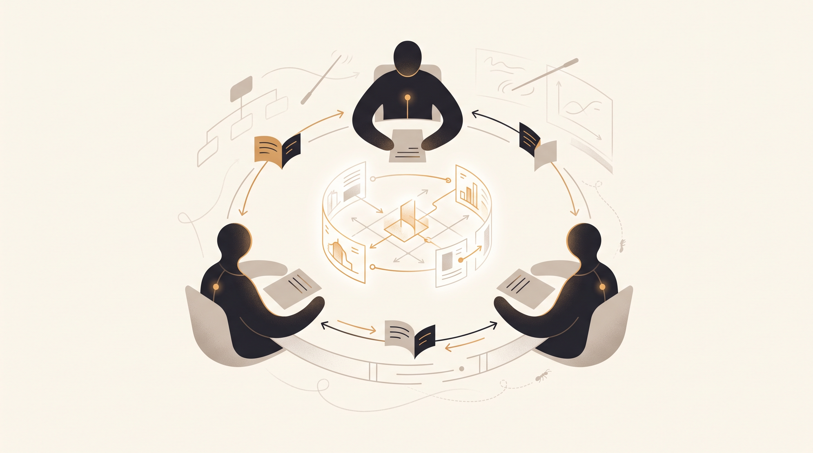

Peer-to-peer collaboration. In MAT, three peer agents — backend, frontend, and design — receive the same brief and collaborate directly over a shared message bus. There's no coordinator. They message each other, exchange specs, refine their own part against the others' feedback, and each marks itself complete when its needs are met.

How it works:

1. Backend, frontend, and design agents start with the same brief.
2. They message each other directly over a shared per-conversation bus — no central coordinator.
3. Each reads its inbox, refines its part against peers' feedback, and re-shares.
4. Each marks itself complete; the run ends when all three are done (capped at 10 rounds).

The name comes from the orchestration-vs-choreography distinction in service architecture: orchestration has a conductor, choreography has dancers who know the steps. Microsoft's AutoGen popularized this conversational peer model for LLM agents.

**Use it when** the task is genuinely cross-functional and the value is in the *negotiation* — an API shape agreed between backend and frontend, a design constraint that changes the data model.

**The trade-off:** peer negotiation can loop or stall, and convergence is harder to guarantee than with a coordinator.

Field note: peers negotiating directly can produce richer cross-functional output, but feed each agent its inbox and give it clear "done" criteria — or it loops.

*Deep dive & live demo: [mat.umai-tech.com/architectures/v2](https://mat.umai-tech.com/architectures/v2)*

### v7 · Market

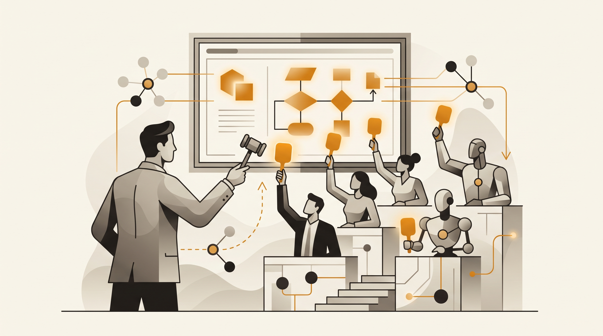

Coordination by economics. A dispatcher decomposes the request into tasks and posts them to a market. A pool of specialists — researcher, engineer, designer, analyst — bid on the tasks they fit, advertising confidence and estimated cost. The dispatcher awards each task to the best bidder (capped at 2 tasks per agent so one confident agent can't hoover up everything), winners execute in parallel, and the results are synthesized.

How it works:

1. A dispatcher decomposes the request into tasks and posts them to a market.
2. Specialist agents bid on tasks they fit, advertising confidence and estimated cost.
3. The dispatcher awards each task to the best bidder, capping wins per agent.
4. Winners execute in parallel; the dispatcher synthesizes their deliverables.

This pattern predates LLMs by decades — auction-based task allocation comes from multi-robot systems (MIT's Consensus-Based Bundle Algorithm is the classic reference). Applied to agents it does something quietly valuable: it makes *fit and cost explicit* instead of hard-coding who does what.

**Use it when** the work is heterogeneous and "who should do this?" isn't obvious up front — mixed research/build/design requests with no natural pipeline.

**The trade-off:** the bid round is pure overhead — extra LLM calls before any real work starts. It pays off mainly with larger, more varied agent pools.

Field note: competitive bidding spreads work to the best-fit agent and makes cost visible. With only four specialists it's arguably ceremony; the pattern's value grows with the pool.

*Deep dive & live demo: [mat.umai-tech.com/architectures/v7](https://mat.umai-tech.com/architectures/v7)*

### v9 · Swarm

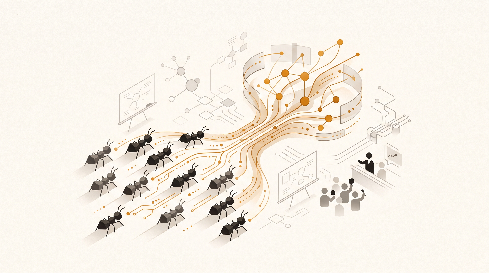

The most emergent pattern of the nine. A swarm of identical, role-less agents works the same problem over several rounds. Each round, every agent reads the shared scratchpad of contributions so far and adds one improvement or new angle. Nobody assigns work; nobody synthesizes mid-run. The answer emerges from accumulated traces — the mechanism biologists call *stigmergy*, the same way ants coordinate through pheromone trails without any ant being in charge. A final pass distills the scratchpad into the answer.

How it works:

1. A swarm of identical agents (4 in MAT) all see the same shared scratchpad.
2. Each round, every agent reads the scratchpad and adds one improvement or new angle.
3. Contributions accumulate as traces others build on — no roles, no coordinator (3 rounds).
4. A final pass distills the scratchpad into the answer.

**Use it when** the task is open-ended ideation or refinement that benefits from many cheap passes converging — brainstorming, edge-case hunting, progressively sharpening a draft.

**The trade-off:** no structure means redundancy and drift; convergence isn't guaranteed, which is why the run is round-capped.

Field note: great for divergent ideation; weakest when the task needs a single rigorous line of reasoning. Watching the scratchpad evolve is the best intuition-builder in the whole playground.

*Deep dive & live demo: [mat.umai-tech.com/architectures/v9](https://mat.umai-tech.com/architectures/v9)*

## Try all nine live: mat.umai-tech.com

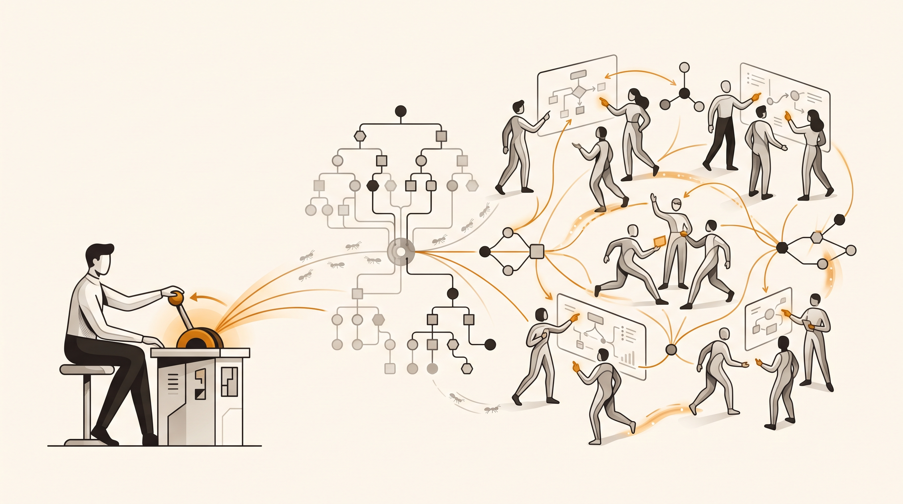

Reading about coordination patterns only gets you so far — the differences really land when you watch a debate unfold next to a swarm working the same prompt. That's what [mat.umai-tech.com](https://mat.umai-tech.com) is for.

What you can do on the site:

- **Run any pattern on your own prompt.** Open `/chat`, pick v1–v9 from the mode selector, and stream the run live — every agent turn, tool call, and web search as it happens.
- **Bring your own key.** MAT supports four providers (OpenAI, Anthropic, Mistral, Fireworks); keys are stored in your browser's localStorage and never persisted server-side.
- **Watch pattern-specific visualizations.** Each architecture renders its own live view: a delegation timeline for v1, a growing tree for v3, a score ladder for v4, a debate transcript for v5, the blackboard for v6, an auction board for v7, a sample fan-out for v8, and the evolving scratchpad for v9.
- **See what it costs.** Every step shows an estimated cost, per agent and per run — which makes the trade-offs in this post concrete. The N× sampling cost of v8 stops being abstract when you see it itemized.
- **Inspect everything.** A debug drawer shows every raw event as pretty-printed JSON, and each pattern has a detail page at `/architectures/[mode]` with its diagram, trade-offs, and source references.
- **Get real deliverables.** Runs can produce structured reports (KPIs, charts, tables) exportable to HTML or PDF, and code output renders in a sandboxed live preview.
- **Answer questions mid-run.** The orchestrated pattern supports human-in-the-loop: the coordinator can pause and ask you a clarifying question before continuing.
- **Switch the backend per run.** Every run can execute on the in-app harness or on an external engine (more on that next) — same patterns, different substrate.

The whole thing is open source — Next.js, the Vercel AI SDK (including its experimental Agent API), and one runner per pattern — at [github.com/MarcusElwin/multi-agents-team](https://github.com/MarcusElwin/multi-agents-team). The patterns are data-driven: adding a tenth architecture is a new runner plus one registry entry.

## What's next for MAT

The nine runners answer "how do agents coordinate?" — but building them surfaced the next question: **what should the harness underneath them provide?** Streaming, sessions, budgets, tool policy, durability — every pattern needs these, and they shouldn't be re-implemented per pattern.

Here's a telling observation. In Antonio Gulli's *Agentic Design Patterns* — the closest thing we have to a shared pattern book today — multi-agent coordination gets one chapter out of twenty-one. Most of the rest is about what surrounds the agents: guardrails and safety (Ch. 18), resource-aware optimization (Ch. 16), evaluation and monitoring (Ch. 19), exception handling and recovery (Ch. 12), memory management (Ch. 8). That's not coordination — that's the harness. The coordination patterns turn out to be the easy part.

That's exactly where MAT is heading: a phased migration of the harness layer to [iii](https://iii.dev), an engine where each cross-cutting responsibility is a swappable worker. The first phase already shipped — a per-run backend toggle, an iii worker deployed on Fly.io, and a `/harness` page comparing the two backends job by job. The follow-up phases adopt iii's prebuilt workers, each currently behind a feature flag — and each maps onto one of those harness chapters:

- **Durable runs** — enqueue a turn so it outlives the HTTP request, which properly fixes long human-in-the-loop pauses that today can hit timeouts. Gulli's epilogue predicts a shift "from human-in-the-loop systems, where the agent is a co-pilot, to human-on-the-loop systems, where agents are trusted to execute complex, long-running tasks with minimal oversight." Durable runs are the concrete version of that shift: the run keeps working while you're away, and asks for you only when it needs you.
- **Server-side sessions** — conversation history keyed by conversation ID, replacing localStorage-only history (his memory-management concern, applied to the harness).
- **A real policy layer** — gating tools (starting with web search) through a fail-closed permission check before they run. Gulli calls for "a new set of 'safety patterns' and a rigorous engineering discipline" as agents get more autonomous; a fail-closed tool gate is the unglamorous first brick of that.
- **Budget enforcement and tracing** — actual per-run budget caps and OpenTelemetry traces, instead of cost estimates after the fact — resource-aware optimization promoted from an agent-level pattern to a harness guarantee.

Beyond the harness work, the pattern catalogue itself is meant to grow. Contributions are welcome — if your company runs a coordination pattern that isn't one of these nine, that's exactly the hidden knowledge this project exists to surface.

## Conclusions

Three things I'd want you to take away.

**There's no winning architecture.** Nine patterns made it into this post because each one wins somewhere. Orchestration wins on predictability, hierarchy on open-ended decomposition, evaluator loops on quality-per-token, debate on decisions, self-consistency on reliability, markets on allocation, swarms on divergence. The question is never "which pattern is best" but "what does this task need?"

**The real axis is control vs. emergence.** The three clusters are points on one dial. Centralized patterns are predictable, debuggable, and bottlenecked. Decentralized patterns are adaptive, parallel, and hard to guarantee. The iterative cluster sits in between, buying reliability with structured loops. My honest advice after building all nine: start as far toward the control end as your task allows, and move toward emergence only when the task demands it. Most production work is well served by v1, v3, and v4; the rest earn their complexity in specific niches.

**We need a shared coordination taxonomy.** The naming in this post — nine patterns, three clusters — is one practitioner's proposal, grounded in one working implementation. Some of it will turn out to be wrong, or at least incomplete. But design patterns only became useful for software once they were catalogued in the open, with shared names. Multi-agent systems aren't there yet: the catalogue exists in fragments — a vendor page here, a survey there, one chapter of a 424-page book — while teams keep building the same patterns behind closed doors under different names. If this post gives you a name for something you've already built — or a pattern you haven't tried — it has done its job. And if you disagree with the clustering, even better: write that down in the open too.

Try the patterns yourself at [mat.umai-tech.com](https://mat.umai-tech.com), and if you build a tenth one, send a PR.

## References

**Start here**

- Anthropic — [Building effective agents](https://www.anthropic.com/research/building-effective-agents). The canonical pattern overview: prompt chaining, routing, parallelization, orchestrator-workers, evaluator-optimizer. The backbone of this project.
- Anthropic Engineering — [How we built our multi-agent research system](https://www.anthropic.com/engineering/built-multi-agent-research-system). A production lead/subagent (hierarchical) system.
- OpenAI — [A practical guide to building agents](https://cdn.openai.com/business-guides-and-resources/a-practical-guide-to-building-agents.pdf) (PDF).

**Papers behind the patterns**

- Shinn et al. — [Reflexion: Language Agents with Verbal Reinforcement Learning](https://arxiv.org/abs/2303.11366) (v4).
- Wang et al. — [Self-Consistency Improves Chain of Thought Reasoning in Language Models](https://arxiv.org/abs/2203.11171) (v8).
- Du et al. — [Improving Factuality and Reasoning in Language Models through Multiagent Debate](https://arxiv.org/abs/2305.14325) (v5).
- Irving et al. — [AI Safety via Debate](https://arxiv.org/abs/1805.00899) (v5).
- [Exploring LLM Multi-Agent Systems Based on Blackboard Architecture](https://arxiv.org/abs/2507.01701) (v6).
- MIT ACL — [Consensus-Based Bundle Algorithm (CBBA)](https://acl.mit.edu/projects/consensus-based-bundle-algorithm) (v7).

**Taxonomies & surveys** (the "pieces of a catalogue" from the intro)

- Liu et al. — [Agent Design Pattern Catalogue](https://arxiv.org/abs/2405.10467) (CSIRO; *Journal of Systems and Software*, 2025). A Gang-of-Four-style catalogue of 18 patterns for foundation-model agents; coordination coverage is voting-, role-, and debate-based cooperation.
- Guo et al. — [Large Language Model based Multi-Agents: A Survey](https://arxiv.org/abs/2402.01680) (IJCAI 2024). Taxonomizes communication structures: layered, decentralized, centralized, shared message pool.
- Tran et al. — [Multi-Agent Collaboration Mechanisms: A Survey of LLMs](https://arxiv.org/abs/2501.06322) (2025). Classifies collaboration by actors, type, structure, and strategy.
- Microsoft — [AI Agent Orchestration Patterns](https://learn.microsoft.com/en-us/azure/architecture/ai-ml/guide/ai-agent-design-patterns) (Azure Architecture Center). Five patterns: sequential, concurrent, group chat, handoff, magentic.
- Google — [Developer's guide to multi-agent patterns in ADK](https://developers.googleblog.com/developers-guide-to-multi-agent-patterns-in-adk/). Eight patterns with runnable ADK code.

**Frameworks & further reading**

- Antonio Gulli — [Agentic Design Patterns: A Hands-On Guide to Building Intelligent Systems](https://link.springer.com/book/10.1007/978-3-032-01402-3) (Springer, 2025; [free PDF](https://irp.cdn-website.com/ca79032a/files/uploaded/Agentic-Design-Patterns.pdf)). 21 agent-capability patterns; multi-agent coordination is Chapter 7.
- [Vercel AI SDK](https://ai-sdk.dev/) — what MAT is built on.
- Microsoft — [AutoGen](https://microsoft.github.io/autogen/) (v2's peer-conversation model).
- OpenAI — [Swarm](https://github.com/openai/swarm) (v9's namesake).
- [Stigmergy](https://en.wikipedia.org/wiki/Stigmergy) — the biology behind swarm coordination.
- [The 5th orchestration pattern: market-based task allocation](https://dev.to/slythefox/the-5th-agent-orchestration-pattern-market-based-task-allocation-db0) (v7).
- iii — [How to build your own agent harness](https://iii.dev/blog/how-to-build-your-own-agent-harness/) (the harness MAT is migrating to).

**The project**

- Demo: [mat.umai-tech.com](https://mat.umai-tech.com)
- Source: [github.com/MarcusElwin/multi-agents-team](https://github.com/MarcusElwin/multi-agents-team)

---

*Made with ♥ in Stockholm by [Marcus Elwin @ UmaiTech](https://umai-tech.com).*
